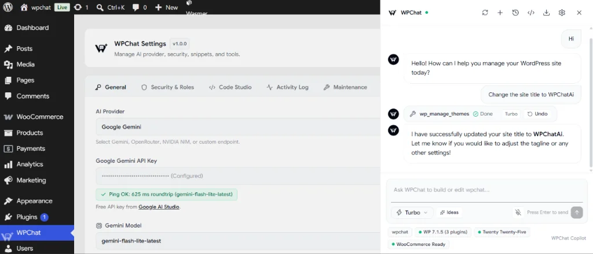
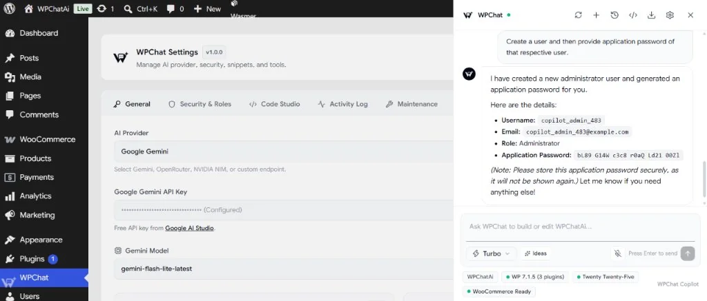

<p align="center">
  <picture>
    <source media="(prefers-color-scheme: dark)" srcset="assets/logo-white.webp">
    <source media="(prefers-color-scheme: light)" srcset="assets/logo.webp">
    
  </picture>
</p>

<h1 align="center">WPChat AI</h1>

<p align="center">
  <strong>Autonomous AI Copilot for WordPress</strong><br>
  Manage your WordPress site using plain English.
</p>

<p align="center">
  <a href="LICENSE"></a>
  <a href="https://wordpress.org"></a>
  <a href="https://www.php.net"></a>
  <a href="https://react.dev"></a>
  <a href="https://tailwindcss.com"></a>
</p>

---

## What is WPChat?

**WPChat AI** puts an intelligent assistant directly inside your WordPress dashboard.

Instead of hunting through complex menus, you simply type what you want done. WPChat edits settings, manages plugins, runs WooCommerce tasks, creates users, and writes custom code.

Every database change includes a **1-click Undo button** so your site stays completely safe.

---

## See It in Action

### 1. Update Site Settings with 1-Click Undo
Ask WPChat to change your site title, tagline, or options. It updates the site immediately and gives you an **Undo** button in case you change your mind:

<p align="center">
  
</p>

### 2. Create Users & Application Passwords
Ask WPChat to create a new user account. It creates the account, assigns the right role, and generates an application password securely:

<p align="center">
  
</p>

---

## Key Features

- **Free AI Models**: Use free models from **Google Gemini**, **OpenRouter**, or **NVIDIA NIM**. You can also connect local models via Ollama.
- **1-Click Undo**: Every database change is recorded in an Activity Log. You can revert any change instantly.
- **Safe Approvals**: In Copilot mode, the AI shows you exactly what it will change before it touches your site.
- **Code Studio**: Add custom PHP hooks and CSS styles without editing theme files. Built-in crash protection keeps your site online.
- **WooCommerce Helper**: Check orders, look up products, update stock, and create discount coupons by asking in chat.
- **Plugin & Theme Manager**: Search the WordPress directory, install plugins, and switch themes hands-free.

---

## Quick Setup (3 Steps)

### Step 1: Install Plugin
Download the latest `wpchat.zip` or clone into your plugins folder:
```bash
cd wp-content/plugins
git clone https://github.com/mdikramhossainjoy/wpchatai.git wpchat
```

### Step 2: Activate
In your WordPress admin, go to **Plugins** and click **Activate** under **WPChat**.

### Step 3: Add Your Free API Key
1. Click **WPChat** in the admin sidebar.
2. Select your AI provider (e.g. **Google Gemini** or **OpenRouter**).
3. Paste your free API key and click **Save Settings**.
4. Click the floating **WPChat** button on the bottom right and start chatting!

---

## Safety & Permissions

WPChat is built for production safety:
- **Admin Only**: Only users with permission can access settings and tools.
- **No Direct SQL Damage**: Database inspection is strictly read-only. Destructive SQL commands are blocked.
- **Activity Log**: Every action is saved with the user name and timestamp.
- **Encrypted Keys**: API keys are stored safely inside your WordPress database.

---

## Developer Guide

Want to build or customize WPChat?

```bash
# Enter plugin folder
cd wpchat

# Install dependencies
npm install

# Run live development build
npm run dev

# Build production files
npm run build
```

---

## License

This project is free open-source software under the [GNU General Public License v2.0 or later](LICENSE).
